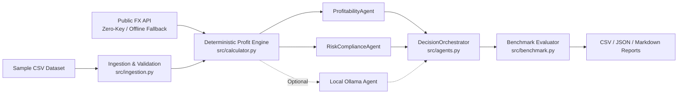

# Cross-Border Arbitrage Multi-Agent Data Pipeline

A zero-API-key, reproducible Python data pipeline and multi-agent evaluation workflow for cross-border e-commerce unit economics (Japan -> Global/US).

> **Compliance-First Design**: This repository intentionally contains **no web scraping code** and requires **no personal API keys**. Instead of scraping restricted marketplaces, it ingests validated CSV datasets, fetches live USD/JPY quotes from public authentication-free FX endpoints (with deterministic offline fallback), separates financial math from agentic risk evaluation, and outputs automated accuracy/latency benchmarks.

---

## Architecture



## Core Engineering Principles

1. **Strict Separation of Concerns (Deterministic Math vs. Agentic Judgment)**
   - Marketplace fees (FVF, international fee, consumption tax), FX conversion spread, US DDP tariffs, weight-tiered shipping tables, and breakeven bounds are computed deterministically in `src/calculator.py`.
   - Qualitative and operational risks (the US `$100` customs/DDP friction threshold, raw ungraded `Near Mint` return risk, counterfeit low-price anomalies, and `SOLD` status) are evaluated by modular specialist agents in `src/agents.py`.
2. **Zero Personal Credentials Required**
   - Runs out-of-the-box on **Python 3.10+ standard library only** (`pip install` not required for core execution).
   - FX rates use public, key-free endpoints (`api.frankfurter.app`, `open.er-api.com`) with automatic fallback (`--offline` flag supported for deterministic CI runs).
   - Agent layer defaults to deterministic specialist agents and exposes a pluggable `BaseEvaluationAgent` interface (including an optional key-free local Ollama adapter).
3. **Built-in Benchmark & Evaluation Harness**
   - Automatically compares **Deterministic Baseline Accuracy** vs. **Multi-Agent Pipeline Accuracy**, calculating Macro-F1, Confusion Matrix, per-item latency (ms), and throughput (items/sec).

## Project Structure

```text
crossborder-arbitrage-pipeline/
├── main.py                      # CLI entrypoint
├── requirements.txt             # Zero runtime dependencies; pytest optional
├── data/
│   └── sample_listings.csv      # Synthetic benchmark dataset (includes edge cases)
├── src/
│   ├── models.py                # Frozen dataclasses & strict type definitions
│   ├── ingestion.py             # Schema validation, anomaly rejection & deduplication
│   ├── fx_client.py             # Key-free public FX client with resilient fallback
│   ├── calculator.py            # Deterministic landed-cost & profit calculation engine
│   ├── agents.py                # Multi-agent risk/profit evaluation & orchestrator
│   ├── benchmark.py             # Latency, throughput, Accuracy, Macro-F1 & Confusion Matrix
│   └── pipeline.py              # End-to-end workflow orchestration & artifact export
├── tests/
│   └── test_pipeline.py         # Unit & end-to-end integration tests
└── outputs/                     # Generated CSV, JSON, and Markdown benchmark reports
```

## Quick Start

### 1. Run End-to-End Pipeline (Offline / Deterministic Mode)

```bash
python main.py --offline
```

### 2. Run with Live Public FX Rate (No API Key Needed)

```bash
python main.py
```

### 3. Run with Optional Local LLM Agent (Ollama)

```bash
python main.py --offline --use-ollama --ollama-model qwen2.5:14b
```

### 4. Run Automated Tests

```bash
python -m unittest discover -s tests -v
```

## Sample Benchmark Output (`--offline`)

On `data/sample_listings.csv` (12 raw rows including 1 invalid negative-price row, 1 duplicate row, and operational risk edge cases):

| Metric | Value |
| :--- | :--- |
| Valid Records Processed | 10 (1 rejected, 1 duplicate removed) |
| Deterministic Baseline Accuracy | 70.0% |
| **Multi-Agent Pipeline Accuracy** | **100.0%** |
| **Multi-Agent Macro-F1 Score** | **1.0000** |

The multi-agent layer improves decision accuracy over the pure financial baseline by catching listings that appear profitable on paper but carry high return/compliance/counterfeit risk (escalating them from `BUY` to `REVIEW`).

> **Note on these numbers:** the `expected_action` labels in the sample CSV are hand-authored to encode the intended decision policy. The scores above show that the pipeline reproduces that policy on a small synthetic set (a regression check); they are not a measure of accuracy on real market data.

## 日本語サマリ（ポートフォリオ概要）

本リポジトリは、**個人のAPIキーや特定サイトのスクレイピングを一切使わずに再現可能**な、Python製マルチエージェント・データパイプラインおよびベンチマーク評価ワークフローの実装例です。

- **安全なデータ入力 (`src/ingestion.py`)**: 規約順守のためスクレイピングは含めず、エッジケース（負の価格・重複・売却済み等）を含むサンプルCSVを入力としてスキーマ検証・重複排除を実行します。
- **キー不要の為替API連携 (`src/fx_client.py`)**: 認証不要の公開為替APIからUSD/JPYレートを取得し、オフライン時やタイムアウト時は安全にフォールバックします。
- **計算と評価の分離 (`src/calculator.py`, `src/agents.py`)**: 手数料・為替スプレッド・米国DDP関税・重量別送料などの厳密な収益計算は決定論的ロジックに任せ、`$100の壁`・`生カードNear Mintの返品リスク`・`異常安値（偽物リスク）`などの定性リスク判定をマルチエージェント層で評価します。
- **自動ベンチマーク評価 (`src/benchmark.py`)**: 実行レイテンシ・スループットに加え、正解ラベルに対する「決定論的ベースライン vs マルチエージェント判定」の精度（Accuracy / Macro-F1 / 混同行列）を自動出力します。

> ※ サンプルCSVの正解ラベル（`expected_action`）は、判定方針に沿って手作業で付与した合成データです。上記の精度は「方針どおりに判定できているか」を確かめる回帰チェックの結果であり、実際の市場データでの予測精度を示すものではありません。
